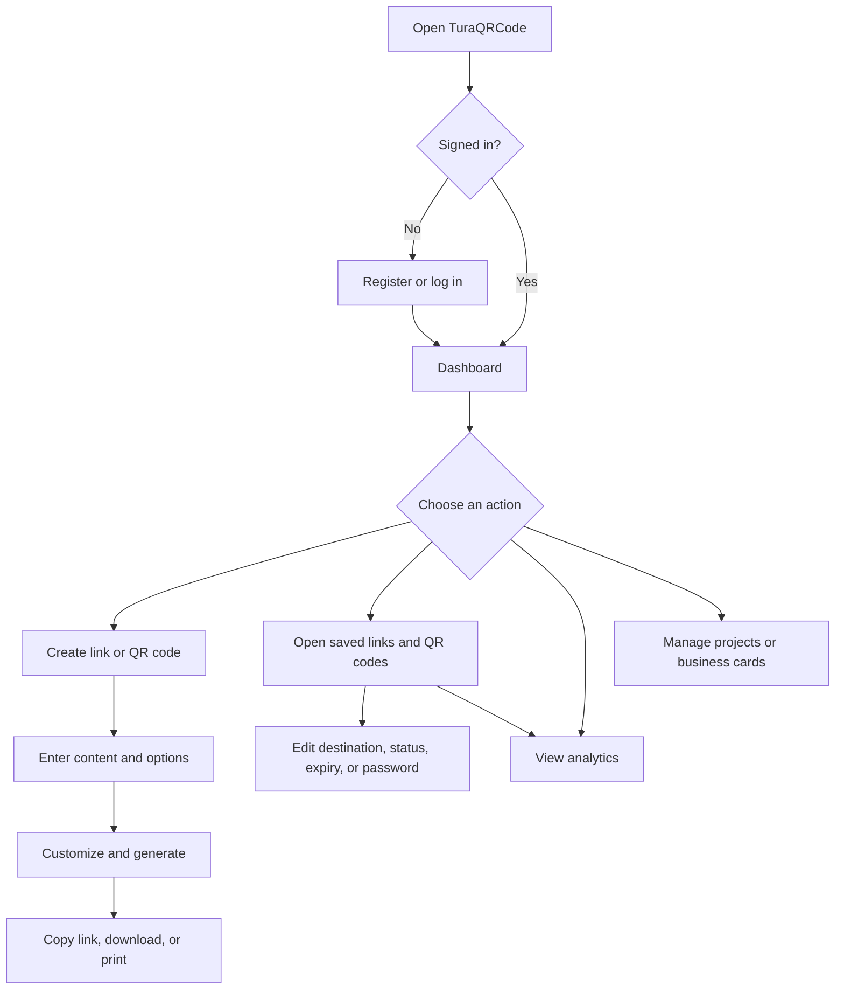
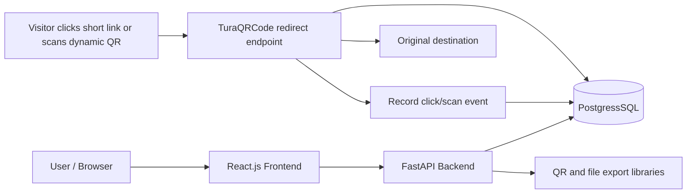

# TuraQRCode — Project Reference

## Project Details

| Item | Details |
|---|---|
| Product name | **TuraQRCode** |
| Parent company | **Turacoz** |
| Frontend | React.js |
| Backend | FastAPI (Python) |
| Database | PostgreSQL on Supabase — connected and migrated |
| Product direction | URL shortener and QR-code creation, customization, management, and analytics platform |
| Implementation principle | Build core functionality in-house; avoid third-party APIs and external integrations unless a requirement makes them necessary |

## Recommended Page Structure — 14 Pages

The application should have **14 main page routes**: 5 public/account-access pages and 9 authenticated product pages. Keep secondary actions—such as renaming a link, deleting a code, or confirming an action—in dialogs or drawers rather than creating unnecessary pages.

| # | Page | Suggested route | Who can access it | Main features on the page |
|---:|---|---|---|---|
| 1 | Home / Landing | `/` | Everyone | Product overview, core capabilities, sign-up and login links, brief explanation of static vs. dynamic QR codes |
| 2 | Login | `/login` | Signed-out users | Email/username and password, validation, link to password recovery |
| 3 | Register | `/register` | Signed-out users | Create account, validate fields, accept terms/privacy notice, then open the dashboard |
| 4 | Forgot Password | `/forgot-password` | Signed-out users | Request a password-reset email using the app's configured email service; if email delivery is not configured in the first release, provide an admin-managed reset process during development |
| 5 | Reset Password | `/reset-password` | Users with a valid reset token | Validate reset token and set a new password |
| 6 | Overview / Dashboard | `/app` | Signed-in users | Summary of links and QR codes, recent click/scan activity, top-performing codes, quick-create action, and recent items |
| 7 | Links & QR Codes | `/app/codes` | Signed-in users | Search, sort, filter, and view saved short links and QR codes; show name, type, destination, created date, status, and click/scan totals; open, edit, disable, or delete an item |
| 8 | Create Link or QR Code | `/app/create` | Signed-in users | Choose URL shortener or QR code; select content type; enter URL/text/contact/Wi-Fi details; choose static or dynamic where relevant; set alias, expiry, password, or redirect rules; customize and save |
| 9 | Code Details / Editor | `/app/codes/:id` | Owner of the item | View a particular link/QR, edit a dynamic destination, customize design, add/change logo, download formats, copy link, set expiry/password, enable/disable, and see recent activity |
| 10 | Analytics | `/app/analytics` | Signed-in users | Total clicks and scans, event timestamps, daily trends, per-link/per-QR results, and best-effort device/referrer details; filter by code and date range |
| 11 | Projects & Campaigns | `/app/projects` | Signed-in users | Create and rename projects, group links/QR codes by client or campaign, and view the items inside each project |
| 12 | Digital Business Cards | `/app/business-cards` | Signed-in users | Create and edit a digital contact profile, add supported contact/social details, generate its QR code, preview, and download/share it |
| 13 | Bulk Create & Print | `/app/bulk` | Signed-in users | Upload/enter a CSV, map columns, validate rows, create multiple links/QR codes, show row-level errors, download results, and arrange QR codes in print layouts |
| 14 | Account Settings | `/app/settings` | Signed-in users | Edit profile, change password, manage account preferences, and review account/session security options |

### Navigation Recommendation

Use a left sidebar for the signed-in product area, following a familiar QR-management dashboard pattern:

- **Overview** → Dashboard
- **Links & QR Codes** → Saved items and management
- **Create** → New link or QR code
- **Analytics** → Click and scan reporting
- **Projects** → Group items by client or campaign
- **Business Cards** → Digital contact cards
- **Bulk & Print** → Batch creation and print layouts
- **Account** → Profile and security settings
- **Logout** → End the current session

Do not build dedicated **Integrations** or **Billing** pages in the first release. Add them only if external integrations or paid subscriptions become actual requirements. A public help page can also be added later if needed.

## Planned Features

| # | Feature | User-facing purpose |
|---:|---|---|
| 1 | URL Shortening | Turn a long URL into a compact link hosted on TuraQRCode. |
| 2 | Custom Aliases | Let users choose a readable ending, such as `yourdomain.com/myshop`, when available. |
| 3 | Editable Destinations | Let users change the destination without changing the short link or dynamic QR code. |
| 4 | Click & Scan Analytics | Track how many times each short link was clicked or dynamic QR code was scanned, including timestamps for individual requests. |
| 5 | Analytics Dashboard | Show totals, daily activity, popular links/codes, and traffic trends. |
| 6 | QR Code Generator | Create codes for common content such as URLs, plain text, email, phone, SMS, Wi-Fi, and contact cards (vCard). |
| 7 | QR Code Customization | Customize colours, patterns, shapes, frames, and backgrounds where supported by the selected library. |
| 8 | Logo Embedding | Place a logo in a QR code, with safeguards to maintain scan reliability. |
| 9 | Download Formats | Export QR codes in practical formats such as PNG, SVG, and PDF, depending on library support. |
| 10 | Link Expiration | Set an optional expiry date and time for a short link or dynamic QR destination. |
| 11 | Password Protection | Require a password before showing protected content or redirecting to the destination. |
| 12 | Enable/Disable Links | Pause and reactivate a link without deleting it. |
| 13 | Link Organization | Name links and group them with folders, categories, or tags. |
| 14 | Bulk URL Shortening | Upload a CSV of URLs and generate short links in one batch. |
| 15 | Bulk QR Generation | Create QR codes in bulk from a CSV or list of supported content. |
| 16 | Print Layouts | Arrange multiple QR codes on print-ready pages. |
| 17 | Custom Branded Domains | Allow configured domains to be used for short links, subject to DNS and hosting setup. |
| 18 | Digital Business Cards | Create a shareable contact profile and its QR code, with an option to download contact details. |
| 19 | Smart Redirects | Apply simple rules, such as sending mobile and desktop visitors to different destinations. Keep the first version to a small set of understandable rules. |
| 20 | QR Code Reports | Show code details and export basic click/scan activity reports where useful. |
| 21 | Project & Campaign Management | Group codes and links by client, department, business, or campaign. |
| 22 | Account Management | Provide registration, login, logout, profile/settings, password change/reset, and secure access to each user's own links, QR codes, projects, and analytics. |

## Typical User Flow

## Basic Architecture

## Small Implementation Plan

1. **Foundation:** Set up the React app, FastAPI service, database schema, authentication, authorization, and user ownership checks.
2. **Core links and QR codes:** Implement URL shortening, unique codes/aliases, redirect handling, QR generation, downloads, and editable destinations.
3. **Dashboard and reporting:** Build Overview, Links & QR Codes, Code Details/Editor, click/scan event recording, analytics, and account settings.
4. **Organization and bulk workflows:** Add projects/campaigns, CSV-based bulk creation, print layouts, business cards, QR customization, and logos.
5. **Additional controls and launch:** Add expiry, password protection, enable/disable, simple smart redirects, custom-domain configuration, security validation, backups, and production logging.

## Important Implementation Notes

- **Analytics require a tracked route.** A dynamic QR code should point to a TuraQRCode redirect URL that records an event and then redirects to the destination. A static QR code that directly contains an external URL cannot reliably report scans to TuraQRCode.
- **Count requests, not guaranteed people.** Store each redirect/scan request with a timestamp. Repeat visits, bots, and link-preview services can affect totals; unique-person counts cannot be guaranteed without additional identification and privacy considerations.
- **Device and referrer details are best-effort.** Browser headers may help infer device/browser details, and referrer data may be missing. Avoid collecting precise location unless there is a justified, consent-aware implementation.
- **Security basics:** Validate destination URLs, protect redirect endpoints from abuse, rate-limit creation endpoints, enforce item ownership, hash passwords securely, expire password-reset tokens, and validate uploaded CSV files.
- **Custom domains:** This requires DNS and hosting configuration. It does not inherently require a paid third-party API, but domain registration and hosting may have costs.
- **Database choice:** PostgreSQL is the selected database. Supabase hosts the application schema. Destructive automated tests use dedicated local PostgreSQL databases, guarded to prevent running against Supabase.

## Implementation decisions — 29 October 2026

The application source is organized into `backend`, `admin`, and `frontend`. Each React application builds independently. Tooling, tests, and design references live inside the appropriate application folder; the root README and deployment guide document the complete project. One root Git repository publishes all three folders to the requested GitHub repository. QRStuff is a feature reference; TuraQRcode uses its own interface and brand identity.

The 14 planned routes are implemented, with additional Terms & Conditions, Privacy Policy, first-password-change, public short-link, and public contact-card routes. Billing and integrations are excluded from this release as planned.

The seven initial content types are URL, plain text, email, telephone, SMS, Wi-Fi, and vCard. Editable destinations and request analytics apply to URL-based codes and short links. Static codes contain fixed content and remain readable independently after download.

| Planned feature group | Initial implementation |
|---|---|
| Shortening, aliases, destination updates | Implemented with globally unique aliases and owner access checks |
| Activity reporting | Click/scan channels, UTC daily trends, devices, referrer hosts, and CSV exports; counts are requests |
| QR customization | Classic, rounded, dots, contrasting colors, scan frame, normalized raster logo |
| Exports and printing | PNG, SVG, PDF, ZIP bundles, and nine-code A4 sheets |
| Link controls | Expiry, access passwords, activation/pause, and a mobile URL rule |
| Projects | Create, rename, delete, assign codes, and filter by project |
| Bulk workflows | CSV upload/paste and column mapping for URLs/text, per-row results, partial success; API accepts all supported types |
| Business cards | Name, title, company, email, telephone, website/social-profile URL, public profile, vCard download, and QR export |
| Account security | Required policy acceptance, Argon2id passwords, HttpOnly sessions, revocation, expiring single-use reset tokens |
| Administration | Separate React app; platform counts, account suspension/restoration, code moderation, account recovery, audit history |
| Branded domain | One deployment hostname through `PUBLIC_BASE_URL`; actual DNS/HTTPS requires an owned domain and deployment |
| Recovery email | SMTP configurable; administrator-managed confidential reset links work without email delivery |

Self-service per-account domain provisioning, multiple social-profile fields, file/media hosting, GS1, billing, and external integrations are future extensions. They are not represented as working features in the interface. See `backend/docs/VERIFICATION.md` for executed checks and setup-dependent limits.
